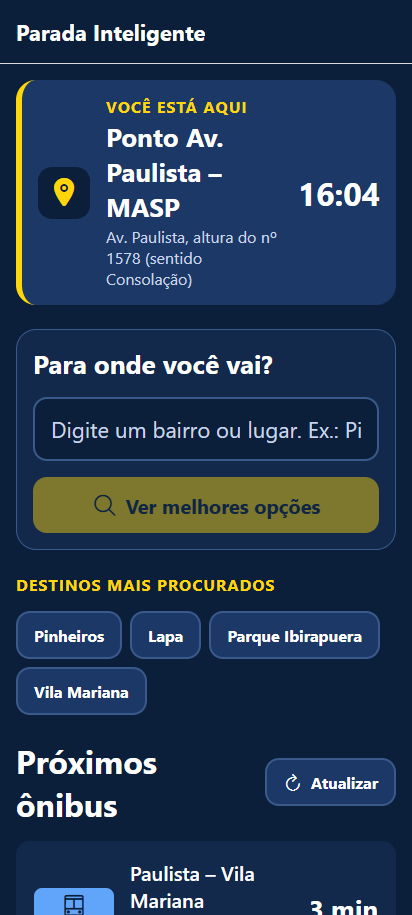
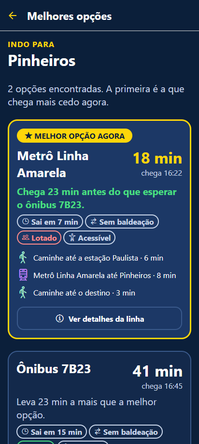
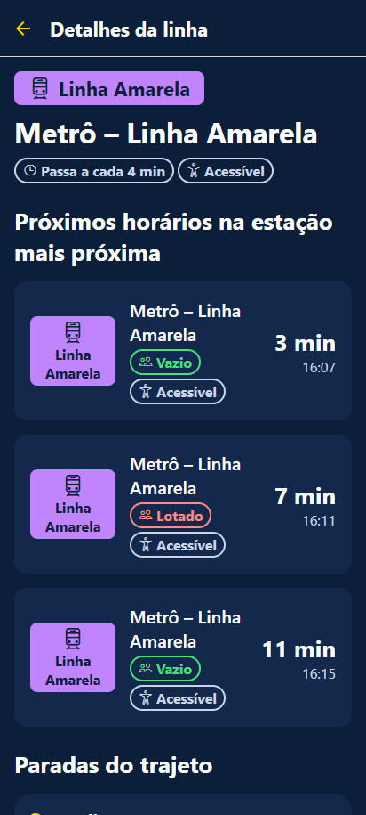
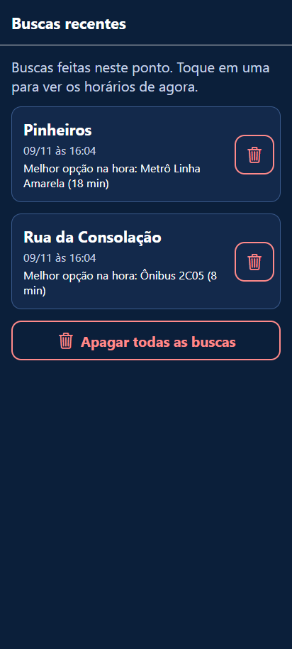
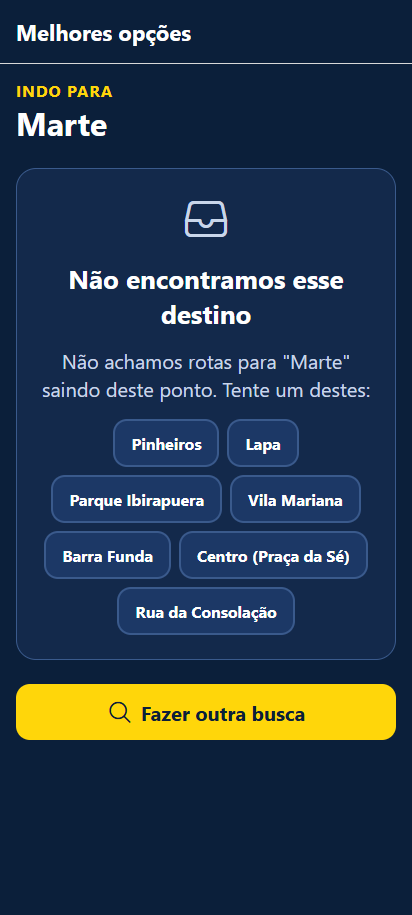

# 🚏 PONTOVOZ — Totem de ponto de ônibus

## Ficha da CitizenTech

| Campo | Descrição |
|---|---|
| **Nome da solução** | PONTOVOZ |
| **Problema** | Quem espera no ponto não sabe quanto tempo falta para o ônibus, nem se o ônibus que vai chegar leva até o seu destino, nem se existe um caminho mais rápido (outro ônibus, metrô, ir a pé ou pegar em outro ponto perto). Isso gera espera longa, ônibus lotados e passageiros esperando no ponto errado. |
| **Cidadão atendido** | Passageiros do transporte público, inclusive idosos, pessoas com deficiência e quem não tem celular ou internet móvel. |
| **Solução** | Um totem com tela de toque instalado no ponto. Ele mostra a contagem regressiva dos próximos ônibus, avisa quais ônibus vão e quais não vão para o destino digitado, compara as alternativas indicando a que chega primeiro e, quando o destino não sai daquele ponto, mostra o ponto mais próximo que atende e o caminho a pé até lá. |
| **Jornada principal** | 1) O passageiro vê os próximos ônibus no totem → 2) digita para onde vai (o totem já mostra exemplos e confirma, enquanto ele digita, se o destino sai dali) → 3) vê quais ônibus vão e quais não vão, e as opções com a melhor em destaque → 4) se o destino não sai daquele ponto, vê o outro ponto e o caminho a pé até ele → 5) consulta os detalhes da linha → 6) a busca fica salva no histórico do totem. |
| **Impacto esperado** | Menos tempo de espera, menos gente esperando no ponto errado, melhor distribuição dos passageiros entre as linhas e acesso à informação sem precisar de smartphone. |

## Integrantes

| Nome | RM | GitHub |
|---|---|---|
| Albert Katri | RM556544 | [@0ldev](https://github.com/0ldev) |
| Bruno Biletsky | RM554739 | [@Bruno-Biletsky](https://github.com/Bruno-Biletsky) |
| Paulo Akira | RM556840 | [@pauloakira05](https://github.com/pauloakira05) |

## Vídeo de demonstração

https://youtu.be/D5Js7WKI6ao

---

## Como rodar o projeto

**Pré-requisitos:** [Node.js 20+](https://nodejs.org) e o app **Expo Go** no celular (Android ou iOS) — ou um emulador Android/iOS.

```bash
# 1. Clonar o repositório
git clone <url-do-repositorio>
cd parada-inteligente

# 2. Instalar as dependências
npm install

# 3. Iniciar o app
npx expo start
```

Depois do `npx expo start`:

| Onde rodar | Como |
|---|---|
| **Celular (Expo Go)** | Leia o QR Code do terminal com o Expo Go (Android) ou com a câmera (iOS). O celular e o computador precisam estar na mesma rede Wi-Fi. |
| **Emulador Android** | Com o emulador aberto, aperte `a` no terminal. |
| **Navegador** | Aperte `w` no terminal (abre em http://localhost:8081). |

Outros comandos úteis:

```bash
npm run typecheck   # confere os tipos do TypeScript (tsc --noEmit)
```

> **Não precisa de `.env`.** O app não usa banco em nuvem nem API com chave. Se no futuro alguém conectar uma API real com chave, ela deve ficar em um arquivo `.env` (já listado no `.gitignore`) e ser lida via `process.env.EXPO_PUBLIC_...`.

> O arquivo `.npmrc` (com `legacy-peer-deps=true`) evita um conflito de versões do `react-dom` no `npm install`.

> **Na versão web**, o SQLite roda via WebAssembly. Por isso existe o [`metro.config.js`](metro.config.js), que libera arquivos `.wasm` e envia os headers COEP/COOP que ele exige. Na web o banco só pode ser aberto por **uma aba por vez**: se o app já estiver aberto em outra aba, a nova mostra um aviso e abre sozinha quando a outra for fechada.

### Roteiro rápido para testar

1. Na tela inicial, veja os **próximos ônibus** com contagem regressiva.
2. Embaixo do campo de busca aparecem **exemplos** separados em "Saem deste ponto" e "Saem de um ponto perto (a pé)".
3. Digite `pinhe` → o totem confirma na hora: ✅ _Pinheiros — sai deste ponto_. Toque nele.
4. Na tela **Melhores opções**, veja o aviso _"Deste ponto, só o ônibus 7B23 vai para Pinheiros"_ e, no fim, a lista com ✅ **Vai** / ❌ **Não vai** de cada ônibus do ponto.
5. Volte e digite `aeroporto` → ↪ _Aeroporto de Congonhas — sai de outro ponto (5 min a pé)_. O app abre a tela **Pegue em outro ponto** com o caminho a pé passo a passo.
6. Digite `Marte` → estado de **lista vazia** ("Não encontramos esse destino").
7. Toque em 🎤 **Falar** e diga, por exemplo, _"Quero ir para Pinheiros"_. No navegador (Chrome/Edge) a fala é transcrita de verdade pela Web Speech API, em português e sem custo. No Expo Go, ou se o microfone for bloqueado, a transcrição é **simulada** com um destino de exemplo. Se só um destino combinar com a fala, o totem abre direto as melhores opções.
8. Abra **Ver buscas recentes**: as buscas feitas foram **salvas no SQLite**. Feche e abra o app de novo — elas continuam lá.

---

## Como resolvemos cada critério da avaliação

| Critério (pontos) | O que pede | Como o app atende | Onde ver no código |
|---|---|---|---|
| **Telas e navegação (2,5)** | Mínimo 3 telas, Expo Router, TypeScript, componentes reutilizáveis e tema centralizado | **6 telas** ligadas à jornada (Início, Melhores opções, Pegue em outro ponto, Detalhes da linha, Buscas recentes, Ônibus no mapa), navegação em pilha com **Expo Router** (rotas por arquivo, rota dinâmica `linha/[id]`, `router.replace` para redirecionar). Tudo em **TypeScript**. **14 componentes** reutilizáveis (um por arquivo). Cores, fontes, espaçamentos, bordas e tamanhos vêm só do tema — nenhuma tela usa número ou cor "solta". | [`app/`](app), [`components/`](components), [`constants/theme.ts`](constants/theme.ts), [`constants/colors.ts`](constants/colors.ts), [`types/index.ts`](types/index.ts) |
| **Consumo de dados (2,0)** | API ou mock, estados de loading, erro e vazio, camada de serviços organizada | Dados **mock** servidos por um cliente que simula uma API real (latência de 0,5 a 1,2 s e **10% de falhas**). Toda tela trata **carregamento** (`<Loading>`), **erro** com "Tentar de novo" (`<Message type="error">`) e **lista vazia** (`<Message type="empty">`). As telas **nunca** leem o mock direto: tudo passa pelo `busService`. | [`services/apiClient.ts`](services/apiClient.ts), [`services/busService.ts`](services/busService.ts), [`constants/mockData.ts`](constants/mockData.ts) |
| **Banco de dados (2,0)** | Dados salvos e recuperados corretamente, acesso ao banco em camada própria | Banco local **SQLite** (`expo-sqlite`). Cada busca é **salva** (destino, melhor opção, tempo, data) e **recuperada** na tela Buscas recentes e nos atalhos da tela inicial; dá para apagar uma ou todas. O SQL fica isolado em um **repositório**; as tabelas são criadas por **migração versionada**; as telas acessam o banco só pelo `useHistory()`. Detalhes na seção [Banco de dados](#banco-de-dados-sqlite-expo-sqlite). | [`database/`](database), [`context/HistoryContext.tsx`](context/HistoryContext.tsx) |
| **Acessibilidade e usabilidade (1,5)** | Contraste, fontes legíveis, `accessibilityLabel` e linguagem simples | Alto contraste (branco/amarelo sobre azul-marinho), fonte mínima de 16 px, botões com 56 px de altura, `accessibilityLabel`/`Role`/`Hint` em tudo que é tocável, leitura em frases completas, `accessibilityLiveRegion` em carregamento, erro e na verificação da busca. "Vai / Não vai" e lotação sempre têm **ícone + texto**, não só cor. Detalhes na seção [Acessibilidade](#acessibilidade-e-usabilidade). | Todos os [`components/`](components) e telas |
| **Aderência ao problema (1,0)** | App coerente com a Ficha, resolvendo a jornada do cidadão | Cada passo da jornada da Ficha tem uma tela: ver próximos ônibus → buscar destino (com exemplos e confirmação) → saber quais ônibus vão ou não → comparar opções → ir a outro ponto se preciso → detalhes da linha → histórico salvo. | [Telas](#telas) |
| **Documentação (1,0)** | README com Ficha, instruções, escolha do banco, prints e vídeo | Este README: Ficha no topo, integrantes, [como rodar](#como-rodar-o-projeto), [banco escolhido e motivo](#banco-de-dados-sqlite-expo-sqlite), [origem dos dados](#de-onde-vêm-os-dados), [prints](#prints) e link do vídeo. | `README.md` |

---

## Telas

| Tela | Rota | O que faz |
|---|---|---|
| **Início do totem** | `app/index.tsx` | Nome do ponto e relógio; campo **"Para onde você vai?"** com **exemplos de destinos** logo abaixo (os que saem deste ponto e os que saem de um ponto perto) e **verificação enquanto digita** (✅ sai deste ponto / 🚶 sai de outro ponto / ❓ não encontrado); atalhos das buscas recentes (do banco); painel **Próximos ônibus** com contagem regressiva, lotação e acessibilidade. Atualiza sozinho a cada 30 s. |
| **Melhores opções** | `app/rotas.tsx` | Aviso de **quais ônibus deste ponto vão para o destino** ("Deste ponto, só o ônibus 7B23 vai para Pinheiros"); compara as alternativas (ônibus direto, metrô, a pé, baldeação), ordena pela que **chega primeiro** e explica a diferença; no fim, a lista de **todos os ônibus do ponto com ✅ Vai / ❌ Não vai** e quando cada um passa. Se o destino só sai de outro ponto, **redireciona** para a tela abaixo. |
| **Pegue em outro ponto** | `app/outro-ponto.tsx` | Quando nenhum ônibus deste ponto vai para o destino: mostra o **ponto mais próximo que atende**, o **caminho a pé passo a passo** (distância, tempo, "vire à direita", "atravesse na faixa"...), o botão **"Como chegar no ponto certo"**, que abre um mapa com o caminho a pé desenhado do totem até o ponto (com a seta de onde virar e o aviso "Pegue aqui o 875A"), a opção completa (a pé + ônibus, com horário de chegada), quais ônibus **daquele ponto** vão ou não vão, e confirma que **nenhum ônibus deste ponto** vai. |
| **Detalhes da linha** | `app/linha/[id].tsx` | Próximos 3 horários (neste ponto, no outro ponto ou na estação), intervalo médio, acessibilidade e todas as paradas do trajeto. |
| **Buscas recentes** | `app/historico.tsx` | Histórico salvo no SQLite: buscar de novo, apagar uma busca ou limpar tudo. |
| **Ônibus no mapa** | `app/mapa.tsx` | Mapa **simulado** do entorno do ponto com o próximo ônibus de cada linha andando até o totem (posição estimada pelo horário previsto). Tocar em um ônibus destaca o caminho dele. A lista embaixo repete tudo em texto grande, com tempo e distância. |

### Prints

| Início do totem | Melhores opções | Pegue em outro ponto |
|---|---|---|
|  |  | |

| Detalhes da linha | Buscas recentes (SQLite) | Histórico vazio | Destino não encontrado |
|---|---|---|---|
|  |  |  |  |

## Estrutura de pastas

```
app/                         # Telas (Expo Router: cada arquivo é uma rota)
  _layout.tsx                # Navegação (Stack) + banco (SQLite) + HistoryProvider
  index.tsx                  # Tela 1 — Início do totem
  rotas.tsx                  # Tela 2 — Melhores opções + quais ônibus vão / não vão
  outro-ponto.tsx            # Tela 3 — Pegue em outro ponto (caminho a pé)
  linha/[id].tsx             # Tela 4 — Detalhes da linha
  historico.tsx              # Tela 5 — Buscas recentes (SQLite)
  mapa.tsx                   # Tela 6 — Ônibus no mapa (simulado)
components/                  # Componentes reutilizáveis (um por arquivo)
  Button.tsx  Loading.tsx  Message.tsx  Tag.tsx
  ArrivalCard.tsx            # Ônibus chegando (contagem regressiva)
  LineCheckCard.tsx          # Ônibus com aviso "Vai para X" / "Não vai para X"
  RouteCard.tsx              # Uma opção de trajeto
  SearchBox.tsx              # Campo de busca + exemplos + verificação ao digitar
  StopHeader.tsx             # "Você está aqui" + relógio
  WalkPath.tsx               # Caminho a pé passo a passo até outro ponto
  RouteDiagram.tsx           # Desenho do trajeto: embarque, sentido do trem, baldeação, desembarque
  MapCanvas.tsx              # Base do mapa simulado: ruas, estações e "você está aqui"
  BusMap.tsx                 # Mapa com os ônibus chegando
  WalkMap.tsx                # Mapa com o caminho a pé até o ponto certo
constants/
  colors.ts                  # Paleta de cores
  theme.ts                   # Fontes, espaçamentos, bordas e tamanhos (tema centralizado)
  mockData.ts                # Dados simulados: pontos, linhas e destinos
context/
  HistoryContext.tsx         # Estado do histórico compartilhado entre as telas
database/
  DatabaseProvider.tsx       # Abre o banco (na web, garante uma aba por vez)
  database.ts                # Criação/migração das tabelas SQLite
  searchHistoryRepository.ts # Único lugar com SQL (insert, select, delete)
services/
  apiClient.ts               # "API" simulada: latência e falhas
  busService.ts              # Próximos ônibus, rotas, outro ponto, vai/não vai, mapa
  speechService.ts           # Busca por voz (Web Speech API ou simulação)
types/index.ts               # Tipos TypeScript
utils/format.ts              # Formatação de horários e textos
utils/geo.ts                 # Mapa simulado: distância e posição dos ônibus
```

## De onde vêm os dados

Todos os dados são **simulados (mock)**, criados pela equipe em [`constants/mockData.ts`](constants/mockData.ts). **Nenhum dado pessoal ou real é usado.** Linhas de ônibus, códigos, pontos, caminhos e tempos de viagem são fictícios, inspirados no transporte de São Paulo. As **estações de metrô** seguem a ordem real das Linhas 1-Azul, 2-Verde e 4-Amarela, para que o trajeto desenhado (ex.: Linha Verde até Consolação, baldeação para a Linha Amarela na estação Paulista) faça sentido para quem conhece a cidade. Os horários continuam simulados.

- O **mapa** de [`app/mapa.tsx`](app/mapa.tsx) é um desenho simplificado (não é um serviço de mapas). A distância do ônibus é estimada pelo tempo que falta, a 9 km/h (média com trânsito), em [`utils/geo.ts`](utils/geo.ts).

- Cada linha tem um **intervalo** (ex.: a cada 15 min) e um deslocamento. Os horários são calculados a partir do relógio do aparelho, por isso a contagem regressiva anda de verdade e muda a cada vez que o app é aberto.
- Um ônibus **"vai para o destino"** quando ele é o primeiro veículo de alguma das opções de rota daquele destino. Os outros ônibus do ponto aparecem como **"não vai"**.
- Os **pontos próximos** (Ponto Rua Augusta, a 5 min a pé, e Ponto Av. Brigadeiro Luís Antônio, a 7 min) têm suas próprias linhas e o caminho a pé descrito passo a passo. Os horários lá consideram o tempo de caminhada.
- A **lotação** é estimada de forma fixa para cada veículo (não muda a cada atualização).
- O [`services/apiClient.ts`](services/apiClient.ts) simula uma API real: latência de 0,5 s a 1,2 s e **10% de chance de falha**, para mostrar os estados de **carregamento** e **erro** (com botão "Tentar de novo"). Para desligar as falhas, mude `failureRate` para `0`.
- O estado de **lista vazia** aparece ao buscar um destino desconhecido (ex.: "Marte") e no histórico quando ainda não há buscas.

**Destinos disponíveis para testar** (também aparecem como exemplos embaixo do campo de busca):

| Saem deste ponto | Saem de um ponto perto (a pé) |
|---|---|
| Pinheiros, Lapa, Parque Ibirapuera, Vila Mariana, Barra Funda, Centro (Praça da Sé), Rua da Consolação | Aeroporto de Congonhas, Cidade Universitária (USP), Estádio do Morumbi, Moema, Santana |

Também aceita apelidos e texto sem acento (ex.: "faria lima", "ibira", "consolacao", "aeroporto", "usp", "zona norte").

Para usar dados reais no futuro, basta trocar `request()` por um `fetch` para uma API de tempo real (ex.: GTFS-Realtime da operadora), mantendo as mesmas funções do `busService`.

## Banco de dados: SQLite (`expo-sqlite`)

**Sim, o app usa banco de dados**, como pede a atividade: um banco **SQLite local** no próprio aparelho (o totem).

**O que é salvo:** cada busca que encontra rotas — inclusive as que mandam para outro ponto — com destino, melhor opção na hora, tempo total, número de opções e data.

**Onde os dados são recuperados:**
- na tela **Buscas recentes** (listar, buscar de novo, apagar uma ou todas);
- nos **atalhos** da tela inicial ("Buscados recentemente neste ponto").

Os dados continuam salvos depois de fechar e abrir o app.

**Por que SQLite:**
- Um totem precisa **funcionar mesmo sem internet**. O banco local não depende de rede.
- É **gratuito**, já vem no Expo Go e não exige conta, chave ou `.env`.
- O histórico pertence ao **totem**, não a uma pessoa. Não há login nem dado pessoal, então não faz sentido mandar isso para a nuvem.

**Organização em camadas:**

```
Telas  ──►  useHistory()  ──►  searchHistoryRepository.ts  ──►  SQLite
          (context/HistoryContext)   (único arquivo com SQL)
```

- [`database/database.ts`](database/database.ts) cria a tabela `search_history` com controle de versão (`PRAGMA user_version`), rodando cada migração uma única vez.
- [`database/searchHistoryRepository.ts`](database/searchHistoryRepository.ts) é o **único lugar com SQL** (`INSERT`, `SELECT`, `DELETE`), sempre com parâmetros `?` (sem concatenar texto).
- [`context/HistoryContext.tsx`](context/HistoryContext.tsx) expõe `saveSearch`, `removeSearch`, `clearHistory` e a lista do histórico para as telas.

## Acessibilidade e usabilidade

- **Alto contraste:** texto branco ou amarelo sobre azul-marinho, pensado para uso ao ar livre.
- **Fontes grandes:** mínimo de 16 px e corpo de 20 px. Botões com no mínimo 56 px de altura.
- **Leitor de tela:** todos os elementos tocáveis têm `accessibilityLabel`, `accessibilityRole` e, quando ajuda, `accessibilityHint`. Os cartões são lidos em frases completas, por exemplo: _"Ônibus 8C10, Paulista – Lapa. Não vai para Pinheiros. Próximo chega em 7 minutos"_. Cada passo do caminho a pé é lido como _"Passo 2 de 6: Na esquina com a Rua Augusta, vire à direita"_. Carregamento, erro e a verificação da busca são anunciados com `accessibilityLiveRegion`.
- **Não depende só de cor:** "Vai / Não vai", lotação e modo de transporte sempre têm ícone e texto junto da cor.
- **Ajuda antes do erro:** os exemplos embaixo do campo mostram o que dá para buscar, e a verificação ao digitar avisa na hora se o destino sai deste ponto, de outro ponto ou se não foi encontrado.
- **Linguagem simples:** "Sai em 4 min", "Chega 14 min antes", "Sem baldeação", "Não vai para Pinheiros", "Ande 5 min até o Ponto Rua Augusta".

## Tecnologias

React Native · Expo SDK 58 · TypeScript · Expo Router · expo-sqlite · @expo/vector-icons (Ionicons)

Todas gratuitas e de código aberto.
